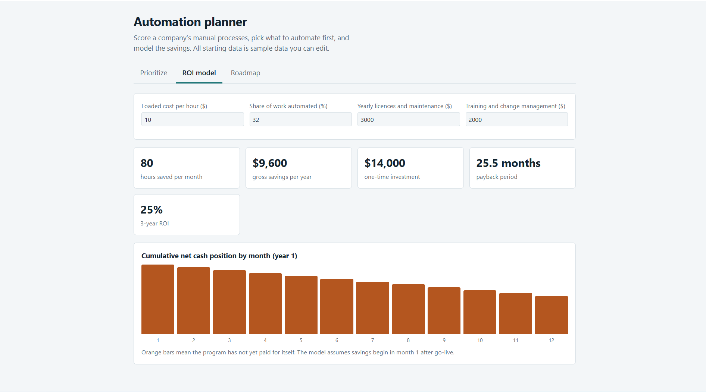

# Automation Planner

An interactive tool that helps a private-sector company decide **which manual processes to automate first** and **what the savings could be**. It is a digital transformation project covering process prioritization, ROI modeling, and an implementation roadmap.

> All data in the tool is **sample data** for demonstration. Figures it produces are modeled estimates, not measured results.


<!-- Add a screenshot of the app here and name the file screenshot.png -->

## Features

- **Prioritize:** Score each process from 1 to 5 on business value, feasibility, and risk. Adjust the weights and get a ranked priority score out of 100. Add your own processes and mark the ones to pilot.
- **ROI model:** Calculates hours saved, yearly savings, one-time investment, payback period, and 3-year ROI for the selected pilots, with a chart of cumulative cash position over year 1.
- **Roadmap:** A 5-phase, 26-week plan (Assess, Prioritize, Design, Build and pilot, Scale and govern) plus an auto-generated pilot shortlist.

## How to run

No installation or dependencies. It is a single HTML file.

1. Download `automation-planner.html` 
2. Open it in any modern browser.

To host it free on GitHub Pages: go to **Settings > Pages**, choose the `main` branch, and save.

## How it works

**Priority score**

```
priority = (value × w1 + feasibility × w2 + (6 − risk) × w3) / (w1 + w2 + w3) / 5 × 100
```

Default weights: value 40%, feasibility 35%, low risk 25%. Risk is reversed so lower risk raises the score.

**ROI model**

```
hours saved     = total monthly hours of pilots × automation share
gross savings   = hours saved × 12 × hourly cost
investment      = sum of build costs + training
payback (months)= investment / ((gross savings − yearly licences) / 12)
3-year ROI      = (3 × savings − 3 × licences − investment) / (investment + 3 × licences)
```

## Assumptions and limitations

- Savings begin in month 1 after go-live, with no ramp-up period.
- The automation share is applied equally to every selected process.
- Data is not saved between sessions; refreshing the page resets it.
- Scores are subjective inputs, so results depend on how they are set.

## Possible improvements

- Export the shortlist and ROI summary to Excel or PDF
- Filter by department
- Sensitivity analysis on automation share and hourly cost
- Save scenarios between sessions

## Tech

HTML, CSS, and vanilla JavaScript. No external libraries.

## Author

ANAS ALQAHTANI | an4salgahtani@gmail.com
